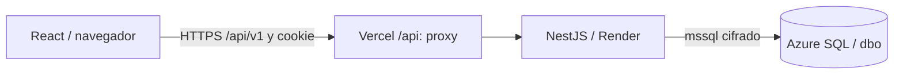

# 01 · Arquitectura y flujo de construcción

Estándar v1 · 21/10/2026. Leer después: [contratos](02-contratos-dtos.md), [endpoints](03-endpoints-bd.md), [seguridad/errores](04-errores-seguridad.md) y [pantallas/diseño](05-frontend-diseno.md).

## Estado y alcance

Las bases frontend, backend y SQL estan integradas en devWilson. La integracion funcional se valida por recorridos; la presencia de un formulario no certifica persistencia ni una prueba con mocks certifica Azure. Entrega: 31/10/2026.

Tres capas y un backend modular, sin microservicios, Redis, crédito, integración SAT ni refresh tokens. Guías operativas y configuración privada permanecen en la carpeta compartida; estos cinco documentos técnicos sí se versionan.

## Tecnologías y responsabilidades

- **Cristian — apps/web:** React, TypeScript, Vite, Tailwind 4, shadcn/ui/Radix, Sonner, Lucide, React Router, TanStack Query, React Hook Form y Zod. Construye pantallas y consume JSON; no accede a SQL ni calcula importes oficiales.
- **Axel — apps/api:** NestJS 11, TypeScript, mssql/Tedious, class-validator/class-transformer, Swagger, Argon2id, JWT y cookie-parser. Valida, autentica, autoriza y adapta DTO↔SQL; no construye interfaz.
- **Angela + Wilson — database:** SQL Server mediante Azure SQL Database, esquema único dbo. Restricciones, transacciones, SP, vistas, reportes y datos sintéticos. Wilson administra accesos y coordina aplicación de scripts; Angela colabora y valida.
- **Entorno:** Node 24 LTS y pnpm 10.34.7; versiones reproducibles en pnpm-lock.yaml. Sin gestores/lockfiles alternativos ni actualizaciones mayores unilaterales.

## Separación de código

- Web: `app` (router/providers/layout), `features/<dominio>` (pages/components/api/hooks/schemas), `components/ui`, `components/shared`, `lib` y `types`.
- API: `modules/<dominio>` con controller → service → repository y dto; `common` para guards/filtros y `database` para un pool reutilizable.
- Módulos: auth/usuarios, clientes/equipos, órdenes/diagnóstico/reparación, inventario, compras/proveedores, facturación/pagos/entrega y reportes/dashboard.
- Todos los objetos SQL usan **dbo**; los módulos son agrupaciones lógicas, no esquemas ni servicios separados.
- No importar clases de Nest en React ni módulos del frontend en Nest. Comparten un contrato HTTP, no su ejecución.

El proxy mantiene un único origen para el navegador; no mueve NestJS a Vercel. En local, Vite debe enviar `/api` a localhost:3000. Configuración y prueba de cookie: documento 04.

## Flujo de una acción

Formulario validado → petición HTTP → guard de sesión/permisos → DTO validado → service → repository parametrizado → SP transaccional → respuesta uniforme → invalidación de consultas de la web.

SQL realiza consumo/recepción/pagos/entrega de forma atómica. El backend no los reconstruye como varios UPDATE independientes. Al fallar, rollback; la interfaz no anuncia éxito sin respuesta confirmada.

Flujo principal: cliente → equipo → orden RECIBIDO → diagnóstico → ESPERANDO_AUTORIZACION → reparación → LISTO → factura → pagos → entrega ENTREGADO.
Abastecimiento: proveedor → compra PENDIENTE → recepción RECIBIDA → inventario/movimientos → consumo en reparación.

## Roles de aplicación

- ADMINISTRADOR: usuarios, catálogos y procesos autorizados; diagnóstico/inicio técnico requieren además TECNICO, como exige el SQL actual.
- RECEPCION: clientes, equipos, ingreso y entrega.
- TECNICO: diagnóstico, reparación, actividades y consumo.
- BODEGA: repuestos, proveedores, bodegas, compras y ajustes.
- CAJA: factura, pagos y entrega. REPORTES_VER permite consultar reportes a los perfiles configurados.

Los permisos reales proceden de UsuarioRol/RolPermiso activos. Ocultar menús no sustituye el guard. Roles SQL del equipo y cuenta técnica de API no son estos perfiles de negocio. Los reportes financieros requieren ADMINISTRADOR o CAJA; los roles restantes conservan las consultas operativas autorizadas. No existe un rol analitico nuevo.

## Secuencia de desarrollo y aceptación

1. Publicar DTO/endpoint en Swagger y su lectura/SP SQL; construir la pantalla contra ese contrato.
2. Integrar primero sesión → clientes/equipos → orden; después servicio/inventario/compras; finalmente finanzas/entrega/reportes.
3. Cada módulo aporta éxito, validación, rechazo por permiso, conflicto de negocio y estados de carga/vacío/error.
4. BD entrega lecturas sin duplicar cabeceras, rollback y escenarios incompletos; se ejecutan T01–T14 y concurrencia con evidencia.
5. Cambio de campo/ruta/error: coordinar Wilson/Axel/Cristian, actualizar Docs, tipos, Swagger y pruebas en el mismo PR; registrar el resumen en seguimiento. No reinterpretar el contrato por separado.
