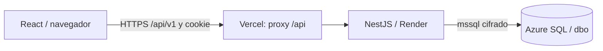

# TechCare Solutions

Sistema de gestión para un taller de reparación de equipos: clientes y equipos,
órdenes de servicio (diagnóstico y reparación), inventario por bodega, compras a
proveedores, facturación, pagos, entrega y reportes.

Monorepo pnpm con tres capas:



| Carpeta | Contenido | Tecnologías |
| --- | --- | --- |
| `apps/web` | Interfaz (SPA) | React, TypeScript, Vite, Tailwind 4, shadcn/ui/Radix, TanStack Query, React Hook Form, Zod |
| `apps/api` | API REST `/api/v1` | NestJS 11, mssql, class-validator, Swagger, Argon2id, JWT en cookie HttpOnly |
| `database` | Scripts SQL | SQL Server 2022 / Azure SQL Database, esquema único `dbo` |
| `Docs` | Documentación técnica | Arquitectura, contratos, endpoints, seguridad, diseño |
| `seguimiento` | Bitácoras, guías y diseño | Diagrama ER generado, guías de despliegue |
| `scripts` | Generadores y chequeos | Node (sin dependencias externas) |

## Requisitos

- Node **24** (`.node-version`) y pnpm **10.34.7** (`corepack enable`).
- SQL Server 2022 local o acceso a la base Azure SQL del proyecto.

## Inicio rápido (local)

```powershell
pnpm install --frozen-lockfile
Copy-Item apps/api/.env.example apps/api/.env   # completar DB_PASSWORD y JWT_SECRET
pnpm dev:api    # http://localhost:3000/api/v1  · Swagger en /docs
pnpm dev:web    # http://localhost:5173 (Vite redirige /api a localhost:3000)
```

`apps/api/.env` es privado y nunca se versiona. Para generar `JWT_SECRET`:

```powershell
node -e "console.log(require('node:crypto').randomBytes(48).toString('base64url'))"
```

## Base de datos

- `database/fases/01..11`: fuente del esquema (tablas, relaciones, funciones,
  vistas, procedimientos, triggers, reportes, permisos y verificación).
- `TechCare_Master.sql` (Azure, BD vacía) y `TechCare_Local.sql` (SQL Server local)
  se **generan** con `pnpm sql:build`; editar las fases, no estos archivos.
- `bootstrap/01_admin_inicial.sql`: crea el primer administrador. El hash se
  genera con `pnpm --filter @techcare/api password:hash`.
- `migraciones/`: cambios sobre una BD ya instalada.
- `semillas/`, `Datos/` y `PruebasBd/`: datos ficticios y pruebas, solo de forma
  manual y fuera de producción.

> Nunca ejecutar el maestro sobre una base con datos. Ningún script SQL se
> ejecuta automáticamente desde el build ni al iniciar la API.

## Comandos

| Comando | Descripción |
| --- | --- |
| `pnpm build` | Compila web y API |
| `pnpm lint` · `pnpm typecheck` · `pnpm test` | Calidad y pruebas unitarias |
| `pnpm --filter @techcare/api test:e2e --runInBand` | Pruebas e2e de la API |
| `pnpm check:structure` | Reglas de estructura del repositorio |
| `pnpm sql:build` · `pnpm sql:check` | Genera / verifica los maestros SQL |
| `pnpm sql:reports:build` · `pnpm sql:reports:check` | Genera / verifica la migración de reportes |
| `pnpm er:build` · `pnpm er:check` | Genera / verifica el diagrama ER |
| `pnpm test:scripts` | Pruebas de generadores y configuración |
| `pnpm deploy:configure-web` · `pnpm deploy:check` | Configura / verifica el proxy de Vercel |

El CI (`.github/workflows/ci.yml`) ejecuta todos los chequeos, más
`pnpm audit --prod`, en cada pull request y en `developer`, `main` y `devWilson`.

## Despliegue

- **Backend:** Render, runtime Node nativo desde la raíz del repo
  (`render.yaml`). Health check: `/api/v1/health`.
- **Frontend:** Vercel, Root Directory `apps/web`, Node 24.x. `apps/web/vercel.json`
  envía `/api/*` al backend, así el navegador usa un único origen y la cookie de sesión.
- **Base de datos:** Azure SQL, con el firewall limitado a las IP de salida de Render.

Paso a paso: [guía de despliegue](seguimiento/guias/despliegue-vercel-render.md).

## Flujo de trabajo

`devNombre` → PR a `developer` → PR a `main` (producción). Merge solo con el CI en verde.

## Documentación

1. [Arquitectura y flujos](Docs/01-arquitectura-flujos.md)
2. [Contratos y DTOs](Docs/02-contratos-dtos.md)
3. [Endpoints y BD](Docs/03-endpoints-bd.md)
4. [Errores y seguridad](Docs/04-errores-seguridad.md)
5. [Frontend y diseño](Docs/05-frontend-diseno.md)

## Equipo

- **Cristian:** frontend (`apps/web`)
- **Axel:** backend (`apps/api`)
- **Angela y Wilson:** base de datos (`database`); Wilson coordina accesos y despliegue
